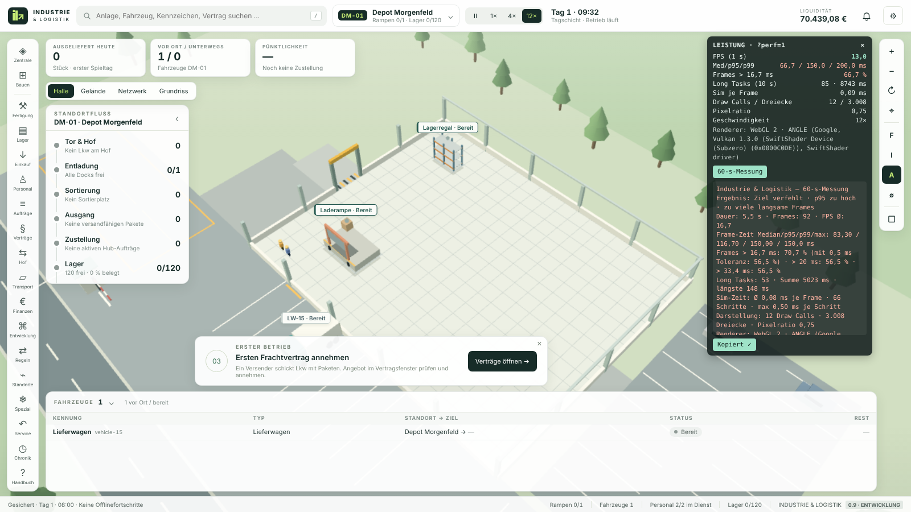

# 60 FPS selbst messen (Messanzeige `?perf=1`)

Stand 0.9 · Welle 1c · A12. Referenzgerät laut `SCHNITTSTELLEN-0.9.md`: Notebook i5-1335U, 16 GB RAM, Intel Iris Xe, aktuelles Chrome oder Edge.

Die Messanzeige erscheint nur, wenn an die Adresse `?perf=1` angehängt wird. Ohne den Parameter läuft kein Messcode. Sie nutzt keine Netzwerkzugriffe und verändert keinen Spielstand.

## Schritte

1. Netzteil anschließen, Energiesparmodus aus, andere rechenintensive Programme und Tabs schließen. Browserfenster maximieren.
2. Spiel mit `?perf=1` öffnen:
   - Online/Server: `…/index.html?perf=1`
   - Portable Datei (z. B. `Industrie-Logistik-Tag-1.html`): im Browser öffnen, dann in der Adresszeile `?perf=1` anhängen und Enter drücken (z. B. `file:///C:/Users/…/Industrie-Logistik-Tag-1.html?perf=1`).
3. Neues Unternehmen gründen (oder vorhandenen Stand laden). Links **Zentrale** öffnen, **„Startbetrieb einrichten“** klicken (erscheint nur, solange er fehlt) und das Fenster mit Esc schließen.
4. Geschwindigkeit **12×** wählen.
5. Ansicht wählen: zuerst **Halle**, für eine zweite Messung **Gelände**.
6. Etwa 5 s warten, dann in der Messanzeige **„60-s-Messung“** klicken. Während der Messung Maus nicht bewegen, Tab nicht wechseln (ein Wechsel macht die Messung ungültig).
7. Nach 60 s erscheint die Zusammenfassung. **„Kopieren“** klicken. Klappt die Zwischenablage nicht, wird ein markiertes Textfeld angezeigt: Strg+C drücken.
8. Text in die Nachricht einfügen und schicken. Am besten je eine Messung für Halle und Gelände.

## Anzeige

| Zeile | Bedeutung |
|---|---|
| FPS (1 s) | Bilder pro Sekunde, gleitend über die letzte Sekunde |
| Med/p95/p99 | Abstand zwischen Bildern der letzten 10 s: Median, 95-%- und 99-%-Wert |
| Frames > 16,7 ms | Anteil der Bilder, die länger als ein 60-Hz-Bild brauchen (letzte 10 s) |
| Long Tasks (10 s) | Blockaden des Browsers über 50 ms: Anzahl und Summe (nur Chrome/Edge) |
| Sim je Frame | Rechenzeit der Spielsimulation, umgelegt auf ein Bild |
| Draw Calls / Dreiecke / Pixelratio | Aufwand der 3D-Darstellung; Pixelratio sinkt automatisch bei Last |
| Grafikqualität | Aktuelle Stufe Niedrig/Mittel/Hoch, „(automatisch)“ bei Einstellung Automatisch (ab 0.15) |
| Renderer | WebGL-Version und Grafikchip (falls der Browser ihn nennt) |
| Geschwindigkeit | Aktuelle Spielgeschwindigkeit |

„ד blendet die Anzeige bis zum Neuladen aus.

## Bewertung

- **Ziel:** p95 ≤ 16,7 ms **und** weniger als 5 % der Frames über 16,7 ms.
- Bei 60-Hz-Bildschirmen schwanken Bildabstände um 16,6–16,8 ms (VSync-Rauschen). Die Bewertung „Ziel erreicht/verfehlt“ rechnet daher mit 0,5 ms Toleranz (Grenze 17,2 ms). Der Rohanteil > 16,7 ms steht zusätzlich im Ergebnis.
- Mehr als 60 FPS sind auf einem 60-Hz-Bildschirm nicht möglich; bei 120 Hz liegt der Median bei etwa 8,3 ms.
- „> 33,4 ms“ entspricht sichtbaren Rucklern (mindestens ein ausgelassenes Bild). Viele Long Tasks deuten auf Rechenlast im Spiel, hohe Draw Calls/Dreiecke auf Grafiklast.

## Grenzen

- Messung im Browser über `requestAnimationFrame`; GPU-Zeit selbst wird nicht gemessen.
- Long Tasks gibt es nur in Chromium-Browsern; Firefox/Safari zeigen „n. v.“.
- Automatischer Browsertest (`tests/browser/perf-overlay-check.mjs`, `npm run perf:browser -- --overlay`) läuft headless mit Software-Rendering. Diese Werte sagen nichts über echte Hardware; maßgeblich ist die Messung auf dem eigenen Gerät.

## Grafikqualität (ab 0.15)

Einstellungen → Darstellung → **Grafikqualität**: Automatisch (Standard), Niedrig, Mittel, Hoch. Rein darstellend, Spielstand unverändert.

| Stufe | Pixelratio max/min | Labels | Details |
|---|---|---|---|
| Niedrig | 1,0 / 0,6 | 16 | keine Bodenschatten, Nachtlicht ohne Lichtkegel/Hallenflächen, wenige Bäume/Autos, LOD ab ~42–50 Einheiten |
| Mittel | 1,25 / 0,7 | 28 | Schatten, Nachtlicht reduziert, LOD ab ~60–75 Einheiten |
| Hoch | 1,5 / 0,75 | 40 | bisherige Darstellung, LOD ab ~95–110 Einheiten |

LOD: entfernte Fahrzeuge nur als Box, Personen ausgeblendet, Pakete halbiert. Automatisch: Start Mittel; p95 der Bildabstände über 10 s; runter bei p95 > 18 ms, hoch erst nach 30 s durchgehend < 13 ms; nach jedem Wechsel neues 10-s-Fenster (kein Flattern). Budget je Stufe: Draw Calls ≤ 150, Dreiecke 60k/120k/250k (Prüfung `node tests/browser/quality.mjs`).

## Erste Nutzermessung Referenzgerät (19.10.2026)

Intel Iris Xe (ANGLE, Direct3D11), Chrome/Edge, `?perf=1`, Grafikqualität Mittel (automatisch), Pixelratio 1,25.
FPS 70 · Median/p95/p99 14,3 / 14,6 / 14,8 ms · 0,0 % Frames > 16,7 ms · Long Tasks 0 · 5 Draw Calls / 2.098 Dreiecke · Spiel **pausiert**, nahezu leere Szene, Tag.
Bewertung A01: Grundlast der Darstellung unkritisch; für 0.18 noch nicht aussagekräftig (pausiert, kaum Objekte, keine Nachtaufnahme). Benötigt: laufendes Spiel (4× oder 12×) mit ausgebautem Hub, Tag und Nacht, Ergebnis der 60-s-Messung.
